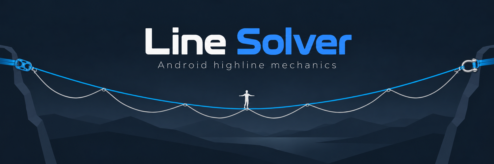

<p align="center">
  
</p>

# Line Solver

**Line Solver** is a native Android application for exploring the mechanics of slackline and highline rigs. It combines a nonlinear, material-aware line solver with an interactive rig editor, a webbing catalogue, and saved configurations.

The central use case is to model a **mainline and an independent backup line**, calculate the rig's loaded equilibrium with a person on the line, and investigate what happens in an **idealized mainline-failure scenario**. The app is intended for engineering exploration, comparison of configurations, and transparent discussion of the assumptions behind rig calculations—not for certifying a rig as safe.

This repository contains the **standalone Android implementation**. The app, numerical solver, material laws, catalogue generation, and JVM tests are written in Kotlin and do not require Python or a backend server. An independent Python project remains the reference implementation for developing models and generating selected regression fixtures.

> [!WARNING]
> **Engineering model, not a safety certificate.** Results depend on material data, rig geometry, idealizations, and numerical convergence. The failure/catch calculation is energy-based; it is **not** a time-resolved dynamics simulation. Do not use calculated forces, safety margins, or predicted clearance as the sole basis for rigging or safety decisions.

## What can the app do?

- **Build a rig:** Configure span and anchor geometry, a pretensioned mainline, and a backup with specified additional length/slack. Use a uniform setup or a mixed, section-based configuration.
- **Assign real webbing models:** Choose materials from an offline catalogue with force–elongation characteristics and, where available, mass and strength information.
- **Place a walker:** Set the person's position and relevant body/leash parameters. The rig visualization and calculations use the same modeled position and geometry.
- **Calculate equilibrium:** Determine the deformed shape and the distribution of load according to the configured geometry, material behavior, and boundary conditions.
- **Explore a mainline failure:** After calculating equilibrium, select a mainline segment to initiate a failure scenario and evaluate the resulting backup-supported configuration using an idealized energy-based catch calculation.
- **Inspect and reuse configurations:** View calculation results and material information, and save rigs for later editing or comparison.

### Mainline, backup, and walker

A highline is not represented as a single cable. Line Solver distinguishes the **mainline**, which is configured using pretension, from the **backup**, whose additional length may form slack loops. Depending on the configuration, the backup can be slack or can already contribute to the intact equilibrium.

The walker is coupled to the line system through the modeled leash ring. In the intact configuration, the ring interacts with the mainline and backup. For a modeled mainline failure, the remaining load path and walker position are evaluated using the backup and leash geometry. Walker height and leash length matter because the modeled displacement of the person's center of mass determines the gravitational energy released during a catch.

<details>
<summary>Physical model in brief</summary>

The equilibrium solver balances geometry, tensile forces, and material force–extension behavior. The constitutive response is material-specific rather than assuming that every webbing has the same linear stiffness. Webbing elastic energy is related to the integral of tension over extension.

For a failure/catch scenario, the change in gravitational potential energy of the walker is conceptually

$$
\Delta E_g = m g (z_{\mathrm{initial}} - z_{\mathrm{catch}})
$$

and is evaluated alongside changes in stored elastic energy and the assumptions of the modeled catch. This can estimate a constrained catch/turning-point configuration, but it does **not** resolve the complete time history of acceleration, oscillation, sliding, impact, or force peaks in a real event.

</details>

## Implementation status

**Development snapshot: October 2026.** This overview reflects the current project documentation and development decisions; it is **not a fresh source-code audit or device-test report**. In particular, the recent separation from the Python repository was designed to preserve existing Android behavior rather than introduce new mechanics.

| Area | Status | Notes |
| --- | --- | --- |
| Native Android app | **Implemented** | Kotlin and Jetpack Compose; independent build and runtime. |
| Simple / uniform rig workflow | **Implemented** | Mainline, backup, walker inputs, equilibrium, and failure analysis. |
| Mixed / section-based workflow | **Implemented** | Configurable material sections; existing workflow retained during migration. |
| Nonlinear material models | **Implemented** | Versioned local material snapshot and offline catalogue. |
| Rig visualization and walker controls | **Implemented; being refined** | Displays mainline, backup, and walker/leash arrangement, with segment selection for failure scenarios. |
| Saved rigs | **Implemented** | Existing saved-rig formats and Android private storage preserved. |
| Energy-based failure/catch calculation | **Implemented** | Idealized analysis; **not** time-domain dynamics. |
| Diagnostic and regression fixtures | **Implemented** | Kotlin/JVM tests, fixed reference cases, and optional JSON-report replay. |
| Bungee editing | **Temporarily unavailable** | Existing work is preserved, but editing is not enabled in the current UI. |
| TypeX connections | **Not exposed in the active UI** | Prior experimental functionality is deferred/archived for later development. |
| Detailed connector assemblies | **Not a completed user-facing workflow** | Research data and regression fixtures are retained; do not confuse them with finished connector modeling. |
| Dynamics, oscillation, and sliding simulation | **Not implemented as a user-facing solver** | Planned separately from the present equilibrium and energy-based catch workflows. |
| Release deployment and on-device validation | **Still requires verification** | Building JVM tests is distinct from installing and testing on physical devices. |

The menu label **Dynamics** is a placeholder for future functionality, not evidence that a time-resolved dynamics solver is available. An additional on-screen hint explaining segment selection after equilibrium calculation has been requested; its inclusion in the current build is **not verified**.

## Scope and current limitations

Line Solver is primarily a **static and energy-based model**. It does not currently provide a validated solution of the full equations of motion for a falling walker, nor should its calculated catch state be interpreted as a measured transient load trace.

Further limitations to keep in mind:

- Real rig behavior can depend on friction, webbing motion through hardware, knot and termination behavior, slipping, damping, contact, dynamic load sharing, and construction details that are not necessarily represented in the current workflow.
- Nonlinear material curves, mass data, minimum breaking strengths, and termination values are only as reliable as the underlying measurements and source attribution. Some materials use explicitly provisional approximations.
- A model result is conditional on its assumptions and input values; a converged numerical answer does not establish sufficient rig strength or redundancy.
- Features retained under `deferred/` or in research fixtures are **not automatically available** in the app.

## Architecture

```text
Android application (Kotlin / Jetpack Compose)
    |
    +-- Rig editor and visualization
    +-- Solver and results
    +-- Material catalogue and saved rigs
    |
    +-- Versioned local material data
    +-- Kotlin/JVM regression tests and reference fixtures

Independent Python reference project
    |
    +-- Model development and numerical cross-checks
    +-- Selected versioned reference fixtures -> Android repository
```

The Android and Python solvers are intentionally **independent implementations**. Kotlin is used natively on Android; Python is not embedded, launched, or needed for builds. Updates to shared material data and regression cases are deliberate, versioned changes rather than live cross-repository dependencies.

### Repository layout

| Path | Purpose |
| --- | --- |
| `app/` | Android application, Kotlin sources, Gradle tasks, and Android/JVM tests. |
| `data/materials/webbing_material_models_v1.json` | Local legacy material-model snapshot; see `data/SNAPSHOT.json` for current snapshot identity. |
| `data/materials/webbings.json` | Original offline catalogue source, including attribution. |
| `data/materials/phase6_connector_research/connector_specs_research.json` | Connector research regression fixture, not a declaration of finished UI support. |
| `catalogue/` | Reviewed reconciliation rules and deterministic generated catalogue outputs. |
| `reference/` and `app/src/test/resources/` | Checked-in numerical, material, and saved-format regression baselines. |
| `specifications/` | Portable mechanics and file-format specifications. |
| `deferred/` | Preserved feature snapshots and regression dependencies for future work. |
| `doc_archive/` | Historical documentation; not the active implementation plan. |
| `branding/` | Branding and data-attribution documentation. |

The material dataset was copied from the earlier Python project during migration; subsequent snapshot changes are tracked in [`data/SNAPSHOT.json`](data/SNAPSHOT.json). Legacy curves have one authoritative representation in the Android data workflow, rather than separately editable duplicates in generated catalogue files. Historical Python source hashes in `reference/manifest.json` document provenance; they do not imply a required sibling checkout.

See also the [material snapshot procedure](data/README.md), [catalogue documentation](catalogue/README.md), and [migration report](MIGRATION_REPORT.md). Python-only oracle/workbook utilities remain in the other project's `scripts/android_reference/` directory.

## Build and test

### Requirements

- JDK **25** for the Gradle daemon toolchain.
- Android SDK **Platform 37 / API 37** and build tools required by Android Gradle Plugin **9.3.2**.
- `JAVA_HOME` and `ANDROID_HOME` configured for the local installation, or `sdk.dir=...` in an ignored `local.properties`.
- Accepted Android SDK licences and internet access for the initial Gradle/Maven dependency downloads.

The included Gradle wrapper uses **Gradle 9.5.0**. No Python environment or server setup is needed.

### Commands

From the repository root:

```sh
# Build the debug APK
./gradlew assembleDebug

# Run Kotlin/JVM unit and regression tests
./gradlew testDebugUnitTest

# Run Android lint
./gradlew lintDebug

# Generate and verify the offline material catalogue
./gradlew :app:generateWebbingCatalogue :app:verifyWebbingCatalogue

# Compile instrumentation-test sources (device execution is separate)
./gradlew assembleDebugAndroidTest
```

Build and test artifacts:

| Artifact | Location |
| --- | --- |
| Debug APK | `app/build/outputs/apk/debug/app-debug.apk` |
| JVM test report | `app/build/reports/tests/testDebugUnitTest/` |
| Android lint report | `app/build/reports/lint-results-debug.html` |

The project defaults to one Gradle worker, a 1 GiB daemon, and a 384 MiB JVM-test heap to suit the established development environment.

An optional replay test can read a diagnostic report with:

```sh
./gradlew testDebugUnitTest -PdebugReport=/path/to/report.json
```

Without `-PdebugReport`, that individual replay test is intentionally skipped. Its JSON input is not required to build the app or run the rest of the JVM tests.

**Device-test precaution:** existing installs may hold private saved rigs and preferences. Preserve those before device testing. Do not uninstall the app or clear its data simply to run tests.

## Compatibility, identity, and signing

The user-facing app name is **Line Solver**. The package identity is intentionally unchanged:

| Property | Current value |
| --- | --- |
| Application ID / namespace | `org.linesolver.base` |
| `versionCode` | `1` |
| `versionName` | `0.1.0` |

The repository migration retained rig file formats, material identities, private storage names, and preferences. An APK with the same application ID and **original signing key** can update an existing installation, subject to Android's version rules. A locally generated debug signing key is **not** a substitute for the original signing identity.

For any future distribution, increment the version code appropriately, protect the original signing key, and provide release signing credentials outside version control. This repository migration did not add a release key or release signing configuration.

## Roadmap

The following areas are **development directions, not announced or implemented features**:

1. Complete UI and device validation of the standalone Android project; improve rig preview, interaction, and failure-selection guidance.
2. Revisit deferred bungee and advanced connector modeling without complicating the standard Simple workflow.
3. Introduce a distinct **Dynamics** solver for time-dependent motion, oscillation, sliding/contact, and corresponding diagnostics, cross-checked against the independent Python reference where applicable.
4. Extend material coverage and strengthen validation of provisional curves, hardware parameters, and numerical regression cases.

Development should preserve the existing Simple/Mixed calculations and their regression baselines while adding new physical effects explicitly rather than silently changing the meaning of existing results.

## Data attribution and licence

Third-party webbing/catalogue data and ISA-related notices are bundled under `app/src/main/assets/licenses/` and explained in [`branding/DATA_ATTRIBUTION.md`](branding/DATA_ATTRIBUTION.md). **Attribution or acknowledgement does not mean that ISA has tested, endorsed, or certified the calculations.** Upstream data licences do not automatically license the application source code.

**No application-wide source-code licence was selected as part of the repository migration.** Do not assume that third-party data notices provide permission to reuse the entire codebase.
